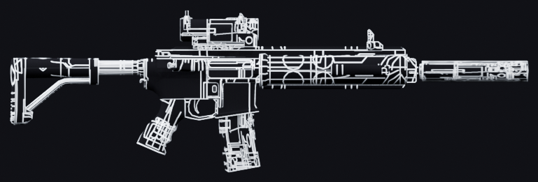
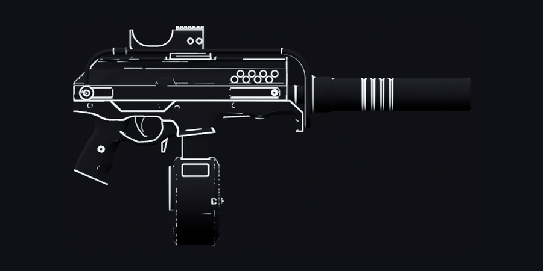
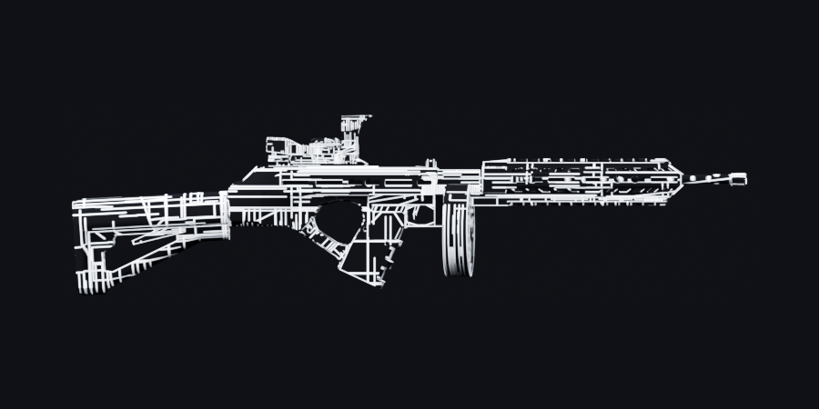

<div align="center">



# GTA5-Gunpack-Black

**Чёрное оружие с белой разделкой.**

[](https://www.rockstargames.com/gta-v)
[](#)
[](LICENSE)

</div>

---

## Что это

Замена оружия для GTA V: почти чёрный корпус и белые линии по стыкам деталей.
Прозрачности нет — «стеклянность» даёт штатный шейдер с отражениями, а не альфа-канал.

Всё лежит в одном `dlc.rpf` — это готовый пак, собирать ничего не нужно.

---

## Что заменено

| Оружие | Геометрия |
|---|---|
| Special Carbine / MK2 | штатная, новая текстура |
| Carbine Rifle | штатная, новая текстура |
| Mini SMG | модель со Sketchfab |
| Assault Shotgun | модель со Sketchfab (Tactical Tommy Gun) |

<table>
<tr>
<td align="center" width="50%">
<br>
<sub>Mini SMG</sub>
</td>
<td align="center" width="50%">
<br>
<sub>Assault Shotgun</sub>
</td>
</tr>
</table>

---

## Лицензия

[MIT](LICENSE) © Arima

Геометрия Assault Shotgun сделана по модели [«Tactical Tommy gun»](https://sketchfab.com/3d-models/tactical-tommy-gun-ddb02fbb7abc415c9aa1b5da9d13bdde)
от [zzzs570](https://sketchfab.com/zzzs570) — [CC-BY-4.0](http://creativecommons.org/licenses/by/4.0/).

---

## Установка

1. Сделай бэкап своего `dlc.rpf`.
2. Скопируй `dlc.rpf` из репозитория в папку `update\x64\dlcpacks\patchday18ng` внутри каталога GTA V:

```
<папка Steam>\steamapps\common\Grand Theft Auto V\update\x64\dlcpacks\patchday18ng\
```

3. Подтверди замену файла и запусти игру.
